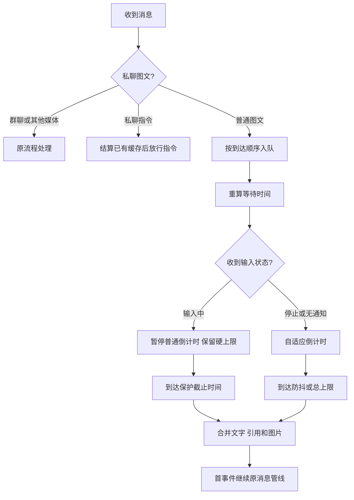

# 消息防抖

合并用户短时间连续发送的私聊图文，再交给 AstrBot 原有处理流程。采用时间规则，无需额外模型、服务或运行依赖。版本：v1.0.0。

作者：臭屁 · [GitHub 仓库](https://github.com/chouoi344/astrbot_plugin_debounce) · [版本记录](CHANGELOG.md)

## 安装

在 AstrBot 插件管理页选择“从链接安装”，填写 `https://github.com/chouoi344/astrbot_plugin_debounce`。也可将整个 `astrbot_plugin_debounce` 文件夹放入 AstrBot 的 `data/plugins/`，重启 AstrBot，在插件管理页配置。兼容声明为 AstrBot `>=4.29.0,<5`、Python 3.10+；接口按 v4.29.0 核对，实际安装还需满足所用 AstrBot 版本自身的 Python 要求。

若已安装另一个同 ID 的 `astrbot_plugin_debounce`，先备份并卸载旧插件，再安装本插件。与其他消息合并插件同时启用时会叠加等待，建议每个会话启用一个防抖插件。市场审核通过后，可在 AstrBot 市场搜索“消息防抖”，选择作者“臭屁”的条目。

## 功能

- 只处理私聊图文；群聊、指令、语音、文件、其他媒体保持原流程。
- 按平台实例、机器人账号、私聊会话隔离；文字保序，图片按来源去重。
- 引用输出 `<quoted_message sender="昵称/ID">`，引用机器人时标注 `Bot`。优先读取 Reply 已有内容，缺失时尝试 OneBot `get_msg`；失败保留引用 ID。
- NapCat/OneBot v11 的 `input_status` 通知控制输入等待，`friend_recall` 通知删除缓冲区对应整条图文和引用。
- 缓存只在内存中；卸载、重启时清空本轮缓存，任务一并回收。

## 配置

| 配置项 | 默认值 | 说明与建议 |
| --- | --- | --- |
| `enabled` | `true` | 插件总开关。 |
| `command_prefixes` | `["/", "#"]` | 这些前缀的指令触发已有缓存结算后放行；空前缀忽略。 |
| `merge_separator` | 换行 | 合并相邻消息所用分隔符。 |
| `adaptive_min_wait` | `1.0` | 单次最小等待，建议 0.5–5 秒。 |
| `adaptive_max_wait` | `6.0` | 单次最大等待，建议 2–15 秒；低于最小值时自动取最小值。 |
| `adaptive_max_total_wait` | `12.0` | 首条消息进入后本轮最多收集时间，建议 5–30 秒。 |
| `adaptive_short_message_threshold` | `10` | 短句字数阈值，建议 5–20。 |
| `enable_typing_detection` | `true` | 使用平台上报的输入状态；无通知时使用时间防抖。 |
| `max_typing_wait` | `60.0` | 单次连续输入的保护时间，建议 10–300 秒；重复输入通知不续期。 |
| `enable_recall_filter` | `true` | 删除防抖期间收到好友撤回通知的消息。 |

单条短消息等待 3 秒，11–50 字等待 2 秒，超过 50 字等待 1.5 秒（短句阈值可调整）。句末 `。！？.!?` 乘以 0.7，末尾 `，,、` 乘以 1.2；缓存包含两条或更多短句且最新消息为短句时，再乘以 1.5，最后限制到单次 min/max 范围。

**总等待上限始终优先。** 正在输入时暂停普通倒计时，保护截止时间取“首条消息 + 总上限”和“首次输入通知 + 输入保护时间”的较早值。默认配置下，即使持续输入也会在本轮 12 秒达到上限；需要更长时间时同时调整总等待上限。接近上限时，实际等待可短于最小等待。

连续短句按提示词中的示例解释：第二条短句入队后即延长到 4.5 秒。提示词中“已有两条再来一条”的描述与该示例存在差异，本实现采用示例和参考伪代码的入队后计数。

## 处理流程



入口使用早期 `event_message_type(ALL)` 钩子。首事件等待 `asyncio.Event`，后续图文追加后停止本次传播。结算时在首事件上更新正文、组件及 OneBot 原始消息链，再交给原来的模型、会话、人格和后续插件处理。保留 AstrBot 原系统提示词；不重复投递事件。

## 使用示例

**连续图文：** 先后发送“今天”“天气”“怎么样”，在最终等待结束后模型收到 `今天\n天气\n怎么样`；两次发送相同图片来源只保留一张。

**完整句子：** “请帮我分析一下这个问题的根本原因。”属于中等长度且以句号结尾，等待 `2 × 0.7 = 1.4` 秒。

**引用：** 引用机器人“今天天气不错”，再发送“那明天呢？”，合并结果：

```xml
<quoted_message sender="Bot">
今天天气不错
</quoted_message>

那明天呢？
```

后续消息各自的引用紧邻对应正文；撤回某一条消息时，其引用、文字、图片一起移除。已交给下游的消息仍按原流程处理。

**指令：** 发送“你好”后发送 `/help`，先完成“你好”的合并重构，再放行 `/help`。此顺序指进入下游处理的顺序，实际回复顺序由模型、指令处理器及其他插件决定。

## 平台与常见问题

**输入状态没有效果？** 需要平台实际上报 `input_status`，NapCat/OneBot v11 对应实现可用；其他平台继续时间防抖。输入通知在已有缓存时生效。

**撤回后仍有回复？** 撤回过滤适用于本轮缓存内收到 `friend_recall` 的消息。结算后已开始的模型请求继续执行。

**图片会下载到本地吗？** 远程图片保持 URL，交给 AstrBot 原有识图流程。适配器传入的本地临时图片会读为内存 base64，避免后续事件结束时文件被框架清理；插件不创建图片缓存文件。

本地图片读取失败或超过本轮硬上限时，会记录警告，并以“图片读取失败或超时，请重新发送图片”占位，避免交付已经失效的临时路径。

**引用解析失败？** 优先使用已有 Reply 内容；OneBot 查询最多等待 3 秒，并受整轮截止时间约束，超时保留引用 ID。纯图消息与其图片照常保留。

**与其他插件如何协作？** 本插件在消息处理早期收集图文，合并结果交给优先级更低的处理器。依赖逐条原始私聊消息的插件需结合实际顺序测试。安装后应使用自己的适配器和模型完成图文、输入通知、撤回验收。

## 开发与贡献

文件按职责划分：`main.py` 管理会话与事件，`message_buffer.py` 保存消息，`adaptive_timer.py` 计算等待，`typing_detector.py` 识别通知，`quote_parser.py` 解析引用。配置采用 AstrBot 原生 schema。

运行独立行为测试：`python -m unittest discover -s tests -v`。反馈问题时提供 AstrBot 与适配器版本、插件配置、最短复现步骤和脱敏日志，可通过 GitHub 仓库提交 Issue / PR。

## 来源与许可证

需求来自用户提供的 `codex_plugin_package/codex_prompt.md` 与 `code_reference.md`；对照 `reference_debounce` 和 `reference_continuous_message` 理解缓冲、事件等待、引用和撤回需求。本插件为重新编写的独立实现，未复制两份参考插件的源码或辅助模块。原参考包保持原样，其 AGPL-3.0 许可证继续适用于原参考代码。

本插件使用 [Apache License 2.0](LICENSE)。AstrBot API 核对基准：[v4.29.0 官方源码](https://github.com/AstrBotDevs/AstrBot/tree/v4.29.0)。
